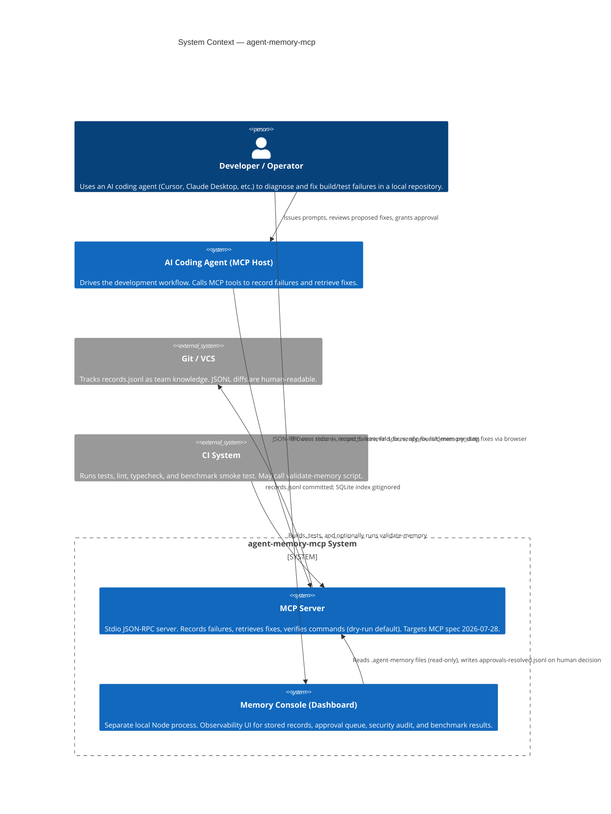
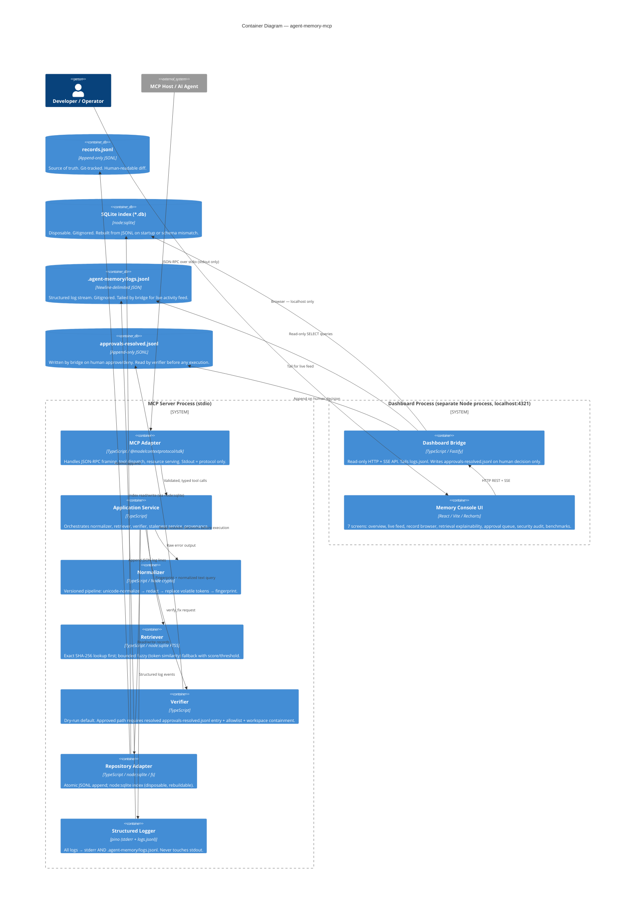
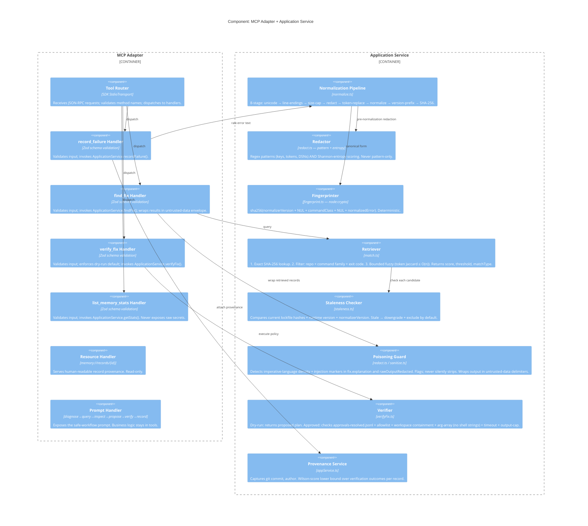
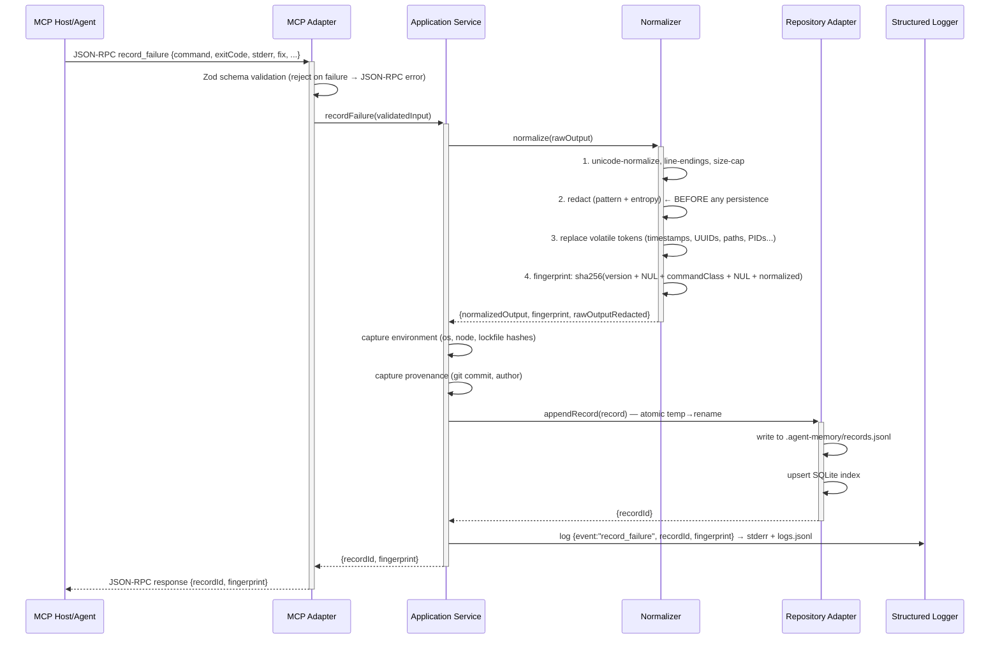
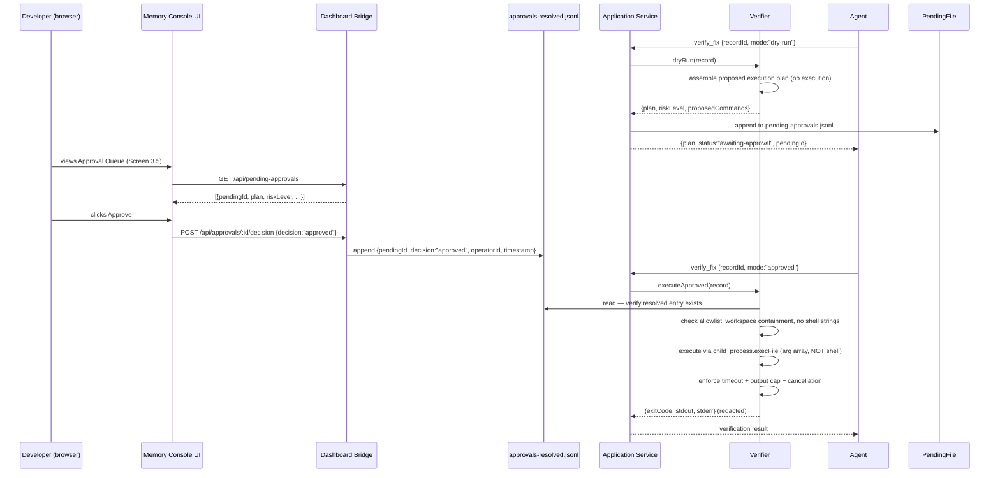

# Architecture — agent-memory-mcp

**Version:** 0.1 (Phase 1 scaffold)
**Date:** 2026-09-10
**Spec target:** MCP 2026-07-28
**Status:** Authoritative — update via ADR before changing structural decisions

---

## 1. System Context (C4 Level 1)



---

## 2. Container Diagram (C4 Level 2)



---

## 3. Component Diagram — MCP Adapter & Application Service (C4 Level 3)



---

## 4. Data Flow — record_failure



---

## 5. Data Flow — find_fix

```mermaid
sequenceDiagram
  participant Agent as MCP Host/Agent
  participant Adapter as MCP Adapter
  participant App as Application Service
  participant Retriever as Retriever
  participant Staleness as Staleness Checker
  participant Poison as Poisoning Guard

  Agent->>+Adapter: JSON-RPC find_fix {stderr, command?, limit?, allowStale?}
  Adapter->>Adapter: Zod validation
  Adapter->>+App: findFix(query)
  App->>+Retriever: query(fingerprint, normalizedText)
  Retriever->>Retriever: 1. Exact SHA-256 lookup in SQLite
  Retriever->>Retriever: 2. If no exact: filter by repo + commandFamily + exitCode
  Retriever->>Retriever: 3. Bounded fuzzy scoring (Jaccard token sim, threshold enforced)
  Retriever-->>-App: candidates[] with {score, threshold, matchType}
  App->>+Staleness: checkStale(candidate, currentEnv)
  Staleness->>Staleness: compare lockfile hashes, normalizerVersion, TTL, verificationStatus
  Staleness-->>-App: {isStale, reasons[]}
  App->>App: exclude stale unless allowStale=true; downgrade rank
  App->>+Poison: wrapUntrusted(candidate.fix.explanation, candidate.rawOutputRedacted)
  Poison->>Poison: check poisoning flag; wrap in delimiters
  Poison-->>-App: wrappedRecord
  App->>App: assemble result with advisory warning
  App-->>-Adapter: ranked candidates with scores, stale reasons, provenance, warning
  Adapter-->>-Agent: JSON-RPC response
  Note over Agent: Agent MUST treat results as advice, not authorization
```

---

## 6. Approval Flow — verify_fix



---

## 7. Key Design Decisions (summary — see ADRs for rationale)

| Decision | Choice | ADR |
|---|---|---|
| Transport | stdio JSON-RPC | ADR-001 |
| Source of truth | Append-only JSONL | ADR-002 |
| Index | node:sqlite (built-in, no native build) | ADR-003 |
| Normalization versioning | Integer version embedded in fingerprint | ADR-004 |
| Redaction strategy | Pattern + entropy (layered) | ADR-005 |
| Command execution | Allowlist + arg array + approval gate | ADR-006 |
| MCP spec version | 2026-07-28 | ADR-007 |
| Dashboard separation | Separate process, no shared stdio | ADR-008 |
| Retrieval poisoning | Sanitization envelope + heuristic flags | ADR-009 |

---

## 8. Failure Mode Analysis

| Failure | Detection | Recovery |
|---|---|---|
| Malformed JSONL line | Parser skips line + logs error | Repair script (docs/operations/repair-jsonl.md); index rebuilt from valid lines |
| Interrupted JSONL write | Atomic temp→rename; incomplete temp file left | On startup: detect incomplete temp file, discard, log |
| SQLite index corrupt/missing | Startup integrity check | Delete *.db, restart — index rebuilt from JSONL |
| Concurrent writers (POSIX) | fs.open with O_APPEND + advisory flock | Documented; see ADR-002 for Windows caveat |
| stdout contamination | ESLint no-console rule; protocol tests assert stdout is valid JSON-RPC | CI fails if stdout contains non-JSON-RPC bytes |
| Secret in record | Pre-persistence redaction required; security test suite | Redaction recall tests on adversarial corpus (Phase 3) |
| Poisoned record retrieved | Poisoning guard wraps content; flag raised | Dashboard Security Audit screen (3.6); excluded from retrieval if confirmed |
