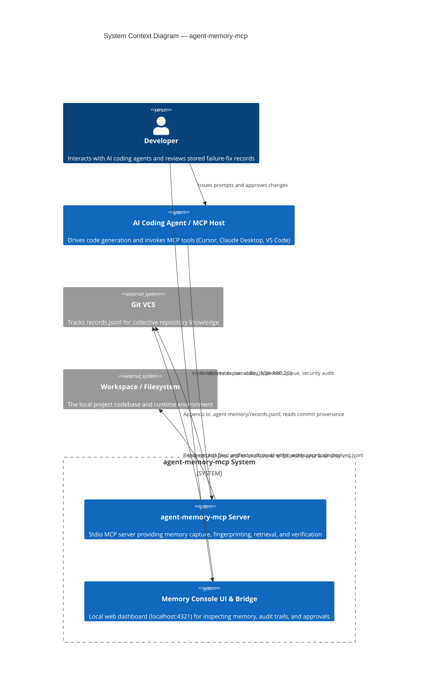
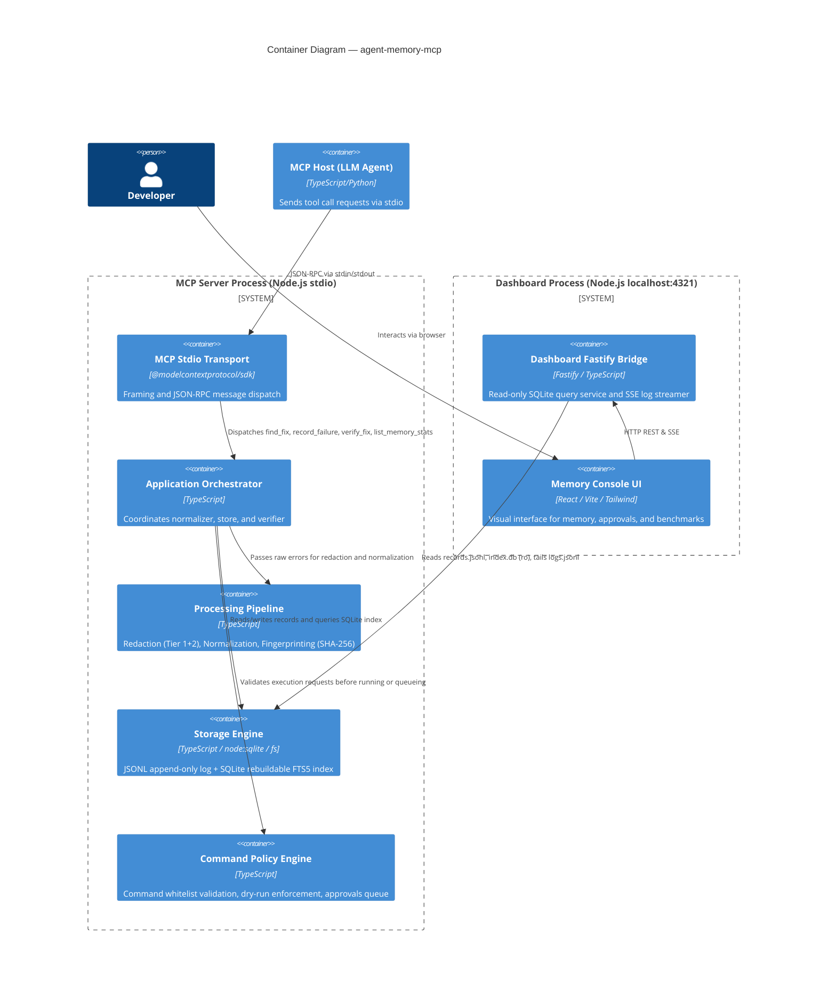
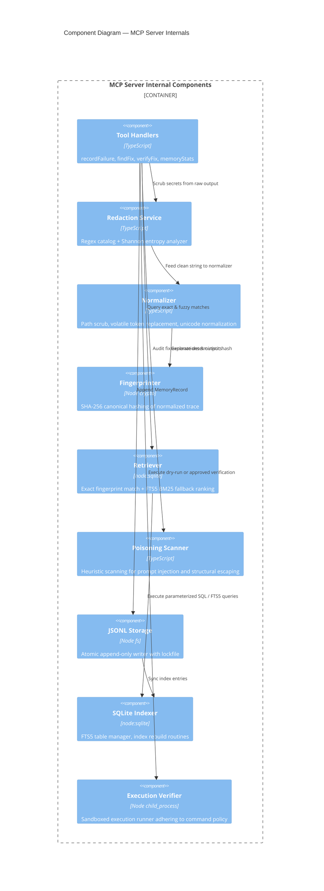

# C4 Architecture Diagrams — agent-memory-mcp

This document contains standalone, detailed Mermaid C4 diagrams for `agent-memory-mcp`.

---

## 1. System Context Diagram (C4 Level 1)



---

## 2. Container Diagram (C4 Level 2)



---

## 3. Component Diagram: MCP Server (C4 Level 3)



---

## 4. Deployment / Process Diagram

```mermaid
graph TD
  subgraph Developer Machine
    subgraph Process: MCP Host IDE
      IDE[Cursor / Claude Desktop]
    end

    subgraph Process: MCP Server Node.js
      direction TB
      StdioIn[stdin] --> ServerCore[MCP Server Core]
      ServerCore --> StdioOut[stdout]
      ServerCore --> StderrLog[stderr - Pino logs]
    end

    subgraph Process: Memory Console Node.js
      Bridge[Dashboard Bridge :4321]
      Static[Static React Frontend]
    end

    subgraph Filesystem: .agent-memory/
      JSONL[(records.jsonl<br/>Source of Truth)]
      DB[(index.db<br/>Rebuildable SQLite)]
      LOGS[(logs.jsonl<br/>Audit Log)]
      APP_PEND[(approvals-pending.jsonl)]
      APP_RES[(approvals-resolved.jsonl)]
    end
  end

  IDE <==>|stdio JSON-RPC| Process: MCP Server Node.js
  ServerCore -->|Append| JSONL
  ServerCore <-->|Read / Write| DB
  ServerCore -->|Append| LOGS
  ServerCore <-->|Queue / Read| APP_PEND
  ServerCore -->|Read Approval| APP_RES

  Bridge -.->|Read Only| JSONL
  Bridge -.->|Read Only| DB
  Bridge -.->|Tail| LOGS
  Bridge -.->|Read| APP_PEND
  Bridge -->|Write Approval| APP_RES

  Bridge --- Static
```
